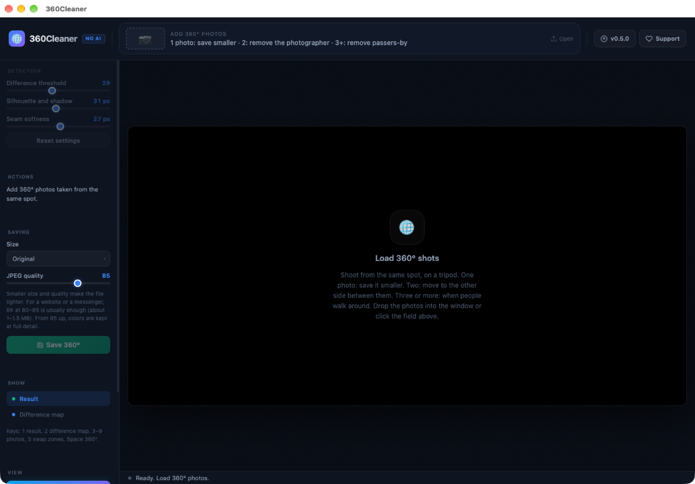

<div align="center">


# 360Cleaner

**Remove the photographer and passers-by from 360° panoramas — and save them up to 20× lighter.**

[](https://github.com/DeMoZ/360cleaner/releases/latest)


[](LICENSE)

**English** · [Русский](README.ru.md) · [ภาษาไทย](README.th.md)

[**⬇ Download**](https://github.com/DeMoZ/360cleaner/releases/latest)



</div>

---

## ✨ What it does

Shoot a few 360° photos from the same spot, drop them into the window, save the result. What happens depends on
how many photos you add:

| Photos | Mode | What you get |
| :---: | :--- | :--- |
| **1** | Re-save | Nothing to remove: the panorama is saved again at the size and quality you pick. With [AI fill](#-ai-fill-optional) on, you can paint the photographer out. |
| **2** | Photographer | You stand on opposite sides in the two shots; each spot is taken from the shot where you aren't. |
| **3+** | Passers-by | For crowded places: each area is taken from a shot where nobody is there. |

- **No AI, nothing made up — by default.** Only real pixels from your own shots, at their original sharpness. The
  optional [AI fill](#-ai-fill-optional) mode, off until you turn it on, can paint in what no shot shows.
- **Stays a 360° photo.** XMP GPano, EXIF and the ICC profile are carried over, so Google Photos, Facebook, VR
  headsets and Insta360 Studio open the result as a sphere.
- **What you see is what you save.** The saved file matches the preview exactly.
- **8 interface languages**: English, Русский, Español, Português, Deutsch, Français, 中文, 日本語.

## 📦 Install

Download the latest version from [**Releases**](https://github.com/DeMoZ/360cleaner/releases/latest).

<details open>
<summary><b>macOS</b> 13.4 or newer (Apple Silicon)</summary>

1. Open `360Cleaner-macOS-v….dmg` and drag the app to **Applications**.
2. The app isn't signed with an Apple certificate, so macOS blocks the first launch: click **Done**, open
   **System Settings → Privacy & Security** and click **Open Anyway**.

The `…-macos-arm64.zip` file in the release is for in-app updates; you don't need to download it.
</details>

<details open>
<summary><b>Windows</b> 10 / 11</summary>

1. Unzip `360Cleaner-…-windows-x64.zip` and run `360Cleaner.exe`.
2. SmartScreen: **More info → Run anyway**.

It needs Microsoft Edge WebView2, which Windows 10/11 usually already has.
</details>

After that the app updates itself: the version button in the top-right corner, plus an automatic check once a day
(you can turn it off).

## 📸 How to shoot

1. Put the camera on a **tripod**. Shot 1: stand on one side.
2. Without moving the tripod, go to the **opposite side** and take shot 2. If people are walking around, take a few
   more: the more shots, the better the chance that every spot is empty in at least one of them.
3. **Drop the photos** into the window (all at once), or click the field at the top. They appear in the list at the
   bottom: click one to view it, ✕ removes it, **Clear list** removes all.
4. With two photos, if you're still in the picture, press **Swap zones** (key <kbd>S</kbd>).
5. Something left that no shot shows (a single photo, a tripod leg)? Turn on [AI fill](#-ai-fill-optional) and
   paint over it.
6. Pick the **format**, **size** and **quality**, then **Save 360°**.

> [!TIP]
> It works best when nothing changes between shots except people: fixed exposure (manual mode), no wind.

## 🪶 File size

A 16K panorama straight from the camera (15520×7760) weighs about 23 MB. Almost all of it is pixels. A 360° viewer
shows about a quarter of the circle on screen at a time, so **6K–8K is enough for a sharp full-screen view**.

| Size | Quality | File |
| :--- | :---: | ---: |
| Original, 15520×7760 | 95 | 22 MB |
| Original, 15520×7760 | 85 | 7.2 MB |
| 8K, 8192×4096 | 85 | **2.5 MB** |
| 6K, 6144×3072 | 85 | **1.6 MB** |
| 5K, 5120×2560 | 80 | **1.0 MB** |
| 4K, 4096×2048 | 80 | **0.7 MB** |

The app downscales with Lanczos and writes a progressive JPEG with optimized tables and 4:2:0 color (4:4:4 at
quality 95 and up). The panorama sizes in the GPano metadata are updated to match.

## 🧊 Cubemap

Instead of the 2:1 panorama you can save a **cubemap**: six square 90° views for game engines and 3D viewers
(Unity, three.js, krpano, Pannellum). The face side is a quarter of the panorama width (an 8K panorama gives
2048×2048 faces), so the detail is the same as at the panorama's equator.

| Format | What you get |
| :--- | :--- |
| **6 files** | `name_f.jpg`, `_r`, `_b`, `_l`, `_u`, `_d`: front, right, back, left, up, down (krpano and Pannellum names). |
| **Strip 6×1** | One file, faces in the order right, left, up, down, front, back (+X −X +Y −Y +Z −Z, as Unity expects). |
| **Cross 4×3** | One file: up and down above and below the front face, empty cells black. |

Front is the middle of the panorama. The top of the up face and the bottom of the down face point backwards. EXIF
and the ICC profile are kept; GPano isn't written, since a face is no longer a sphere.

A cubemap in any of these three layouts can also be **opened**: the program recognises it by itself (a 6:1 strip,
a 4:3 cross with black empty cells, or the six files `name_f` … `name_d` next to each other — add any of them, they
count as one photo), turns it into a 4n×2n panorama and works with it as usual. The save format is set to the
first photo's own (strip, cross, 6 files or panorama), and you can change it; a panorama saved from a cubemap gets
GPano.

## 🪄 AI fill (optional)

A separate mode for what the shots can't fix: one photo only, someone standing in the same place on every shot, a
tripod leg. Paint over it and the [LaMa](https://github.com/advimman/lama) model draws what could be behind it.

1. Turn on **Fill in with AI** in the **AI fill** section. The first time, the model is downloaded (208 MB, from
   [Carve/LaMa-ONNX](https://huggingface.co/Carve/LaMa-ONNX), Apache-2.0) and checked by SHA-256.
2. Pick the **Brush** (<kbd>B</kbd>) and paint on the result in the flat view. <kbd>Alt</kbd>/<kbd>Option</kbd> erases,
   <kbd>Shift</kbd> + drag moves the picture, <kbd>⌘/Ctrl</kbd>+<kbd>Z</kbd> undoes a stroke.
3. Press **Fill in**. Each painted area is filled in its own perspective view, so the panorama's distortion near the
   poles doesn't get in the way; the first fill also loads the model (about 5 s), then 2–3 s per area.

Everything runs on your computer; photos aren't sent anywhere. What the model paints is made up, not photographed:
filled areas are marked in the window, and the saved file gets `_ai` in its name. The model works at 512×512, so a
large area (a person right next to the camera) comes out softer than the rest of an 8K panorama. An area wider than
about 120° is refused: paint it in parts. On Windows AI fill hasn't been tried on a real machine yet.

## 🎛 Settings

| Setting | What it does |
| :--- | :--- |
| **Difference threshold** | How different the shots must be (ΔE in Lab). Lower it if clothes match the background; raise it if leaves and noise get caught. With two photos, if noise covers too much of the frame, the threshold is raised automatically and the status bar says to what value. |
| **Silhouette and shadow** | How far to grow the found area: hair, clothing edges, the shadow on the floor. |
| **Seam softness** | Width of the smooth blend between shots. |
| **Swap zones** | Two photos only: swaps which shot each of the two zones comes from. The border between the zones keeps clear of people, so nobody is cut in half. |
| **Difference map** | Two photos: blue zone A and red zone B, where people were found. Three or more: each area in the color of the shot it was taken from (the same dot as in the photo list). |
| **Format** | 360° panorama or a cubemap: 6 files, strip 6×1 or cross 4×3 (see above). |
| **Size, JPEG quality** | How to save the result. No upscaling: sizes larger than the original aren't offered. Next to the quality, the approximate file size is shown while you move the slider. |
| **360° sphere** | Interactive view: drag with the mouse, scroll to zoom. <kbd>Space</kbd> toggles it. |
| **Aspect ratio** | 2:1, 16:9, 4:3, 1:1, 9:16 or 4:5 frame, for viewing only. |

**Keys:** <kbd>1</kbd> result · <kbd>2</kbd> difference map · <kbd>3</kbd>–<kbd>9</kbd> photos · <kbd>S</kbd> swap
zones · <kbd>B</kbd> AI brush · <kbd>Space</kbd> 360° · <kbd>⌘/Ctrl</kbd>+<kbd>O</kbd> add photos · <kbd>⌘/Ctrl</kbd>+<kbd>S</kbd>
save

## 🛠 Build from source

Rust + the system WebView (tao + wry), parallel processing with Rayon.

```bash
cargo run --release                         # run
cargo run --release -- a.jpg b.jpg c.jpg    # run with photos
cargo test                                  # tests
scripts/build-macos.sh                      # dist/360Cleaner.app, .dmg and the update .zip (Apple Silicon)
```

## ❤️ Support

The app is free. The **Support** button in the window lists ways to donate; the list comes from
[DeMoZ/donations](https://github.com/DeMoZ/donations).

## 📄 License

[MIT](LICENSE). Built in: [ONNX Runtime](https://onnxruntime.ai) (MIT) through [ort](https://github.com/pykeio/ort)
(MIT / Apache-2.0). Downloaded on first use of AI fill: the LaMa model (Apache-2.0).
