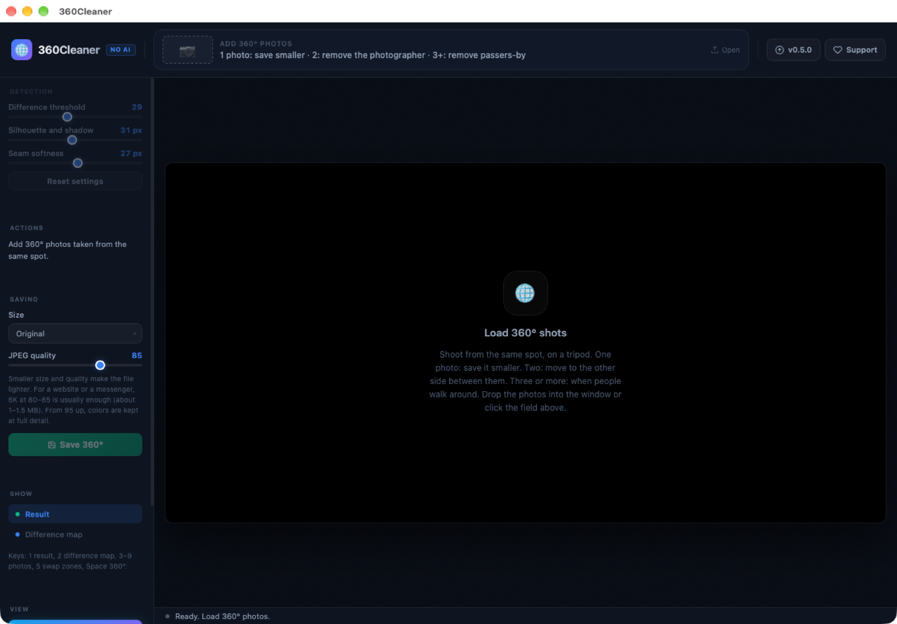

<div align="center">


# 360Cleaner

**Убирает фотографа и прохожих с 360° панорамы и сохраняет её в 20 раз легче.**

[](https://github.com/DeMoZ/360cleaner/releases/latest)


[](LICENSE)

[English](README.md) · **Русский** · [ภาษาไทย](README.th.md)

[**⬇ Скачать**](https://github.com/DeMoZ/360cleaner/releases/latest)



</div>

---

## ✨ Что делает

Снимите несколько 360° фото с одной точки, перетащите их в окно, сохраните результат. Что получится, зависит от
числа фото:

| Фото | Режим | Что получается |
| :---: | :--- | :--- |
| **1** | Пересохранение | Убирать нечего: панорама сохраняется заново с выбранными размером и качеством. С [ИИ-дорисовкой](#-ии-дорисовка-по-желанию) можно закрасить и убрать фотографа. |
| **2** | Фотограф | На двух кадрах вы стоите с разных сторон; каждое место берётся с кадра, где вас нет. |
| **3+** | Прохожие | Для людных мест: каждое место берётся с кадра, где там никого нет. |

- **Без нейросетей, ничего не дорисовывается — по умолчанию.** Только настоящие пиксели ваших кадров в исходной
  резкости. Отдельный режим [ИИ-дорисовки](#-ии-дорисовка-по-желанию) выключен, пока вы его не включите.
- **Остаётся 360° фото.** XMP GPano, EXIF и профиль ICC переносятся, поэтому Google Photos, Facebook, VR-шлемы и
  Insta360 Studio открывают результат как сферу.
- **Сохраняется то, что видно.** Файл в точности совпадает с превью.
- **8 языков интерфейса**: English, Русский, Español, Português, Deutsch, Français, 中文, 日本語.

## 📦 Установка

Скачайте последнюю версию со страницы [**Releases**](https://github.com/DeMoZ/360cleaner/releases/latest).

<details open>
<summary><b>macOS</b> 13.4 и новее (Apple Silicon)</summary>

1. Откройте `360Cleaner-macOS-v….dmg` и перетащите приложение в «Программы».
2. Приложение не подписано сертификатом Apple, поэтому первый запуск macOS блокирует: нажмите «Готово» (Done),
   откройте «Системные настройки → Конфиденциальность и безопасность» и нажмите «Всё равно открыть» (Open Anyway).

Файл `…-macos-arm64.zip` в релизе нужен для обновления из программы, скачивать его не надо.
</details>

<details open>
<summary><b>Windows</b> 10 / 11</summary>

1. Распакуйте `360Cleaner-…-windows-x64.zip` и запустите `360Cleaner.exe`.
2. SmartScreen: «Подробнее» → «Выполнить в любом случае».

Нужен Microsoft Edge WebView2 — в Windows 10/11 он обычно уже есть.
</details>

Дальше программа обновляется сама: кнопка с номером версии в правом верхнем углу и автоматическая проверка раз в
сутки (её можно выключить).

## 📸 Как снимать

1. Камера на **штативе**. Кадр 1: встаньте с одной стороны.
2. Не двигая штатив, перейдите на **противоположную сторону** — кадр 2. Если вокруг ходят люди, снимите ещё
   несколько: чем больше кадров, тем больше шансов, что каждое место хоть на одном из них пустое.
3. **Перетащите фото** в окно (сразу все) или нажмите на поле вверху. Они появятся в списке внизу: щелчок
   показывает фото, ✕ убирает его, «Очистить список» — все.
4. Для двух фото: если вы остались на снимке, нажмите «Поменять зоны» (клавиша <kbd>S</kbd>).
5. Осталось то, чего нет ни на одном кадре (фото всего одно, видна нога штатива)? Включите
   [ИИ-дорисовку](#-ии-дорисовка-по-желанию) и закрасьте это.
6. Выберите **формат**, **размер** и **качество** и нажмите «Сохранить 360°».

> [!TIP]
> Лучше всего работает, когда между кадрами меняются только люди: одинаковая экспозиция (ручной режим), нет ветра.

## 🪶 Вес файла

16K-панорама с камеры (15520×7760) весит около 23 МБ. Почти весь вес — пиксели. Просмотрщик 360° показывает на
экране примерно четверть окружности, поэтому **для чёткой картинки на весь экран хватает 6K–8K**.

| Размер | Качество | Файл |
| :--- | :---: | ---: |
| Исходный, 15520×7760 | 95 | 22 МБ |
| Исходный, 15520×7760 | 85 | 7,2 МБ |
| 8K, 8192×4096 | 85 | **2,5 МБ** |
| 6K, 6144×3072 | 85 | **1,6 МБ** |
| 5K, 5120×2560 | 80 | **1,0 МБ** |
| 4K, 4096×2048 | 80 | **0,7 МБ** |

Уменьшение — Lanczos, запись — прогрессивный JPEG с оптимизированными таблицами и цветом 4:2:0 (от качества 95 —
4:4:4). Размеры панорамы в метаданных GPano пересчитываются под новый размер.

## 🧊 Кубическая карта

Вместо панорамы 2:1 можно сохранить **кубическую карту** (cubemap): шесть квадратных видов по 90° для игровых
движков и 3D-просмотрщиков (Unity, three.js, krpano, Pannellum). Сторона грани — четверть ширины панорамы (из 8K
получаются грани 2048×2048), так что подробность та же, что на экваторе панорамы.

| Формат | Что получится |
| :--- | :--- |
| **6 файлов** | `имя_f.jpg`, `_r`, `_b`, `_l`, `_u`, `_d`: вперёд, вправо, назад, влево, вверх, вниз (имена как у krpano и Pannellum). |
| **Полоса 6×1** | Один файл, грани в порядке вправо, влево, вверх, вниз, вперёд, назад (+X −X +Y −Y +Z −Z, как ждёт Unity). |
| **Крест 4×3** | Один файл: верх и низ над и под передней гранью, пустые клетки чёрные. |

Вперёд — середина панорамы. Верх верхней грани и низ нижней смотрят назад. EXIF и профиль ICC сохраняются, GPano —
нет: грань уже не сфера.

Кубическую карту любого из этих трёх видов можно и **открыть**: программа узнаёт её сама (полоса 6:1, крест 4:3 с
чёрными пустыми клетками или шесть файлов `имя_f` … `имя_d` рядом — добавьте любой из них, это одно фото), переводит
в панораму 4n×2n и дальше работает как обычно. Сохранить можно в любом формате; у панорамы из кубической карты
появляется GPano.

## 🪄 ИИ-дорисовка (по желанию)

Отдельный режим для того, что кадрами не исправить: фото всего одно, человек стоит на одном месте на всех кадрах,
видна нога штатива. Закрасьте это, и модель [LaMa](https://github.com/advimman/lama) дорисует, что могло быть за ним.

1. Включите «Дорисовывать ИИ» в разделе «ИИ-дорисовка». В первый раз скачается модель (208 МБ, из
   [Carve/LaMa-ONNX](https://huggingface.co/Carve/LaMa-ONNX), Apache-2.0) с проверкой SHA-256.
2. Возьмите «Кисть» (<kbd>B</kbd>) и рисуйте по результату в плоском виде. <kbd>Alt</kbd>/<kbd>Option</kbd> — стереть,
   <kbd>Shift</kbd> + перетаскивание — двигать картинку, <kbd>⌘/Ctrl</kbd>+<kbd>Z</kbd> — отменить мазок.
3. Нажмите «Дорисовать». Каждое закрашенное место дорисовывается в своём виде с перспективой, поэтому искажения
   развёртки у полюсов не мешают. Первая дорисовка ещё загружает модель (около 5 с), дальше 2–3 с на место.

Всё считается на вашем компьютере, фото никуда не отправляются. Дорисованное — выдумка модели, а не снимок: такие
места отмечены в окне, а в имени сохранённого файла будет `_ai`. Модель работает с картинкой 512×512, поэтому большое
место (человек вплотную к камере) выходит мягче остальной 8K-панорамы. Место шире примерно 120° не берётся:
закрасьте его по частям. В Windows дорисовку на настоящем компьютере ещё не проверяли.

## 🎛 Параметры

| Параметр | Что делает |
| :--- | :--- |
| **Порог различий** | Насколько сильно должны различаться кадры (ΔE в Lab). Понизьте, если одежда похожа по цвету на фон; повысьте, если реагирует на листья и шум. Для двух фото: если шума слишком много, порог поднимается сам, и строка состояния показывает, до какого значения. |
| **Захват силуэта и тени** | На сколько расширить найденную область: волосы, края одежды, тень на полу. |
| **Смягчение шва** | Ширина плавного перехода между кадрами. |
| **Поменять зоны** | Только для двух фото: меняет, из какого кадра берётся каждая из двух зон. Граница между зонами обходит людей и не режет человека пополам. |
| **Карта различий** | Для двух фото — голубая зона A и красная зона B, где найдены люди. Для трёх и больше — каждое место цветом кадра, из которого оно взято (как точка у фото в списке). |
| **Формат** | Панорама 360° или кубическая карта: 6 файлов, полоса 6×1 или крест 4×3 (см. выше). |
| **Размер, качество JPEG** | С чем сохранить результат. Увеличения нет: размеры больше исходного не предлагаются. Рядом с качеством виден примерный вес файла, он меняется вместе с ползунком. |
| **360° сфера** | Интерактивный просмотр: тяните мышью, колесо — масштаб. <kbd>Пробел</kbd> — переключить. |
| **Кадрирование** | Рамка 2:1, 16:9, 4:3, 1:1, 9:16 или 4:5 — только для просмотра. |

**Клавиши:** <kbd>1</kbd> результат · <kbd>2</kbd> карта различий · <kbd>3</kbd>–<kbd>9</kbd> фото · <kbd>S</kbd>
поменять зоны · <kbd>B</kbd> кисть ИИ · <kbd>Пробел</kbd> 360° · <kbd>⌘/Ctrl</kbd>+<kbd>O</kbd> добавить фото · <kbd>⌘/Ctrl</kbd>+<kbd>S</kbd>
сохранить

## 🛠 Сборка из исходников

Rust + системный WebView (tao + wry), обработка параллельно через Rayon.

```bash
cargo run --release                         # запуск
cargo run --release -- a.jpg b.jpg c.jpg    # запуск с фото
cargo test                                  # тесты
scripts/build-macos.sh                      # dist/360Cleaner.app, .dmg и .zip для обновления (Apple Silicon)
```

## ❤️ Поддержать

Программа бесплатная. Кнопка «Поддержать» в окне ведёт на способы доната; список берётся из
[DeMoZ/donations](https://github.com/DeMoZ/donations).

## 📄 Лицензия

[MIT](LICENSE). Встроены: [ONNX Runtime](https://onnxruntime.ai) (MIT) через [ort](https://github.com/pykeio/ort)
(MIT / Apache-2.0). Скачивается при первом включении ИИ-дорисовки: модель LaMa (Apache-2.0).
