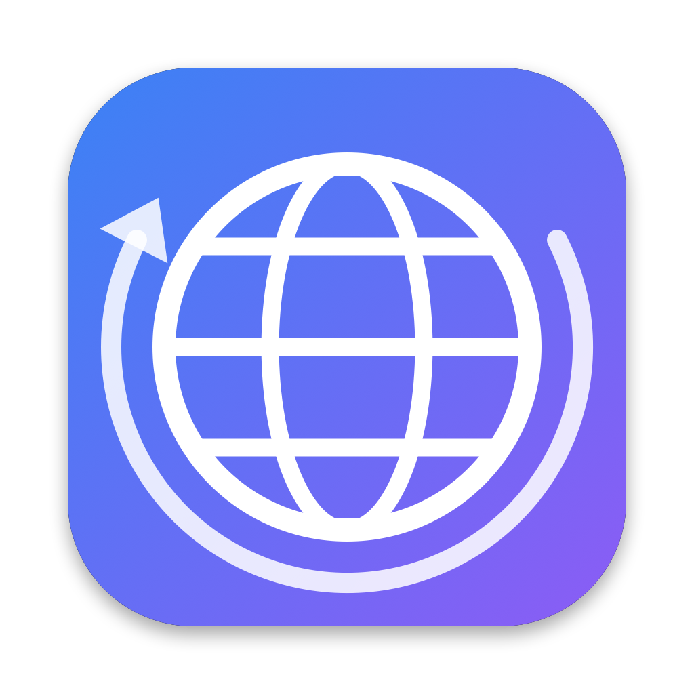

<div align="center">



# 360Cleaner

**Убирает фотографа и прохожих с 360° панорамы и сохраняет её в 20 раз легче.**

[](https://github.com/DeMoZ/360cleaner/releases/latest)


[English](README.md) · **Русский** · [ภาษาไทย](README.th.md)

[**⬇ Скачать**](https://github.com/DeMoZ/360cleaner/releases/latest)

</div>

---

## ✨ Что делает

Снимите несколько 360° фото с одной точки, перетащите их в окно, сохраните результат. Что получится, зависит от
числа фото:

| Фото | Режим | Что получается |
| :---: | :--- | :--- |
| **1** | Пересохранение | Убирать нечего: панорама сохраняется заново с выбранными размером и качеством. |
| **2** | Фотограф | На двух кадрах вы стоите с разных сторон; каждое место берётся с кадра, где вас нет. |
| **3+** | Прохожие | Для людных мест: каждое место берётся с кадра, где там никого нет. |

- **Без нейросетей, ничего не дорисовывается.** Только настоящие пиксели ваших кадров в исходной резкости.
- **Остаётся 360° фото.** XMP GPano, EXIF и профиль ICC переносятся, поэтому Google Photos, Facebook, VR-шлемы и
  Insta360 Studio открывают результат как сферу.
- **Сохраняется то, что видно.** Файл в точности совпадает с превью.
- **8 языков интерфейса**: English, Русский, Español, Português, Deutsch, Français, 中文, 日本語.

## 📦 Установка

Скачайте последнюю версию со страницы [**Releases**](https://github.com/DeMoZ/360cleaner/releases/latest).

<details open>
<summary><b>macOS</b> (Apple Silicon)</summary>

1. Откройте `360Cleaner-macOS-v….dmg` и перетащите приложение в «Программы».
2. Приложение не подписано сертификатом Apple, поэтому первый запуск macOS блокирует: нажмите «Готово» (Done),
   откройте «Системные настройки → Конфиденциальность и безопасность» и нажмите «Всё равно открыть» (Open Anyway).

Файл `…-macos-arm64.zip` в релизе нужен для обновления из программы, скачивать его не надо.
</details>

<details open>
<summary><b>Windows</b> 10 / 11</summary>

1. Распакуйте `360Cleaner-…-windows-x64.zip` и запустите `360Cleaner.exe`.
2. SmartScreen: «Подробнее» → «Выполнить в любом случае».

Нужен Microsoft Edge WebView2 — в Windows 10/11 он обычно уже есть.
</details>

Дальше программа обновляется сама: кнопка с номером версии в правом верхнем углу и автоматическая проверка раз в
сутки (её можно выключить).

## 📸 Как снимать

1. Камера на **штативе**. Кадр 1: встаньте с одной стороны.
2. Не двигая штатив, перейдите на **противоположную сторону** — кадр 2. Если вокруг ходят люди, снимите ещё
   несколько: чем больше кадров, тем больше шансов, что каждое место хоть на одном из них пустое.
3. **Перетащите фото** в окно (сразу все) или нажмите на поле вверху. Они появятся в списке внизу: щелчок
   показывает фото, ✕ убирает его, «Очистить список» — все.
4. Для двух фото: если вы остались на снимке, нажмите «Поменять зоны» (клавиша <kbd>S</kbd>).
5. Выберите **размер** и **качество** и нажмите «Сохранить 360°».

> [!TIP]
> Лучше всего работает, когда между кадрами меняются только люди: одинаковая экспозиция (ручной режим), нет ветра.

## 🪶 Вес файла

16K-панорама с камеры (15520×7760) весит около 23 МБ. Почти весь вес — пиксели. Просмотрщик 360° показывает на
экране примерно четверть окружности, поэтому **для чёткой картинки на весь экран хватает 6K–8K**.

| Размер | Качество | Файл |
| :--- | :---: | ---: |
| Исходный, 15520×7760 | 95 | 22 МБ |
| Исходный, 15520×7760 | 85 | 7,2 МБ |
| 8K, 8192×4096 | 85 | **2,5 МБ** |
| 6K, 6144×3072 | 85 | **1,6 МБ** |
| 5K, 5120×2560 | 80 | **1,0 МБ** |
| 4K, 4096×2048 | 80 | **0,7 МБ** |

Уменьшение — Lanczos, запись — прогрессивный JPEG с оптимизированными таблицами и цветом 4:2:0 (от качества 95 —
4:4:4). Размеры панорамы в метаданных GPano пересчитываются под новый размер.

## 🎛 Параметры

| Параметр | Что делает |
| :--- | :--- |
| **Порог различий** | Насколько сильно должны различаться кадры (ΔE в Lab). Понизьте, если одежда похожа по цвету на фон; повысьте, если реагирует на листья и шум. |
| **Захват силуэта и тени** | На сколько расширить найденную область: волосы, края одежды, тень на полу. |
| **Смягчение шва** | Ширина плавного перехода между кадрами. |
| **Поменять зоны** | Только для двух фото: меняет, из какого кадра берётся каждая из двух зон. |
| **Карта различий** | Для двух фото — голубая зона A и красная зона B, где найдены люди. Для трёх и больше — каждое место цветом кадра, из которого оно взято (как точка у фото в списке). |
| **Размер, качество JPEG** | С чем сохранить результат. Увеличения нет: размеры больше исходного не предлагаются. |
| **360° сфера** | Интерактивный просмотр: тяните мышью, колесо — масштаб. <kbd>Пробел</kbd> — переключить. |
| **Кадрирование** | Рамка 2:1, 16:9, 4:3, 1:1, 9:16 или 4:5 — только для просмотра. |

**Клавиши:** <kbd>1</kbd> результат · <kbd>2</kbd> карта различий · <kbd>3</kbd>–<kbd>9</kbd> фото · <kbd>S</kbd>
поменять зоны · <kbd>Пробел</kbd> 360° · <kbd>⌘/Ctrl</kbd>+<kbd>O</kbd> добавить фото · <kbd>⌘/Ctrl</kbd>+<kbd>S</kbd>
сохранить

## 🛠 Сборка из исходников

Rust + системный WebView (tao + wry), обработка параллельно через Rayon.

```bash
cargo run --release                         # запуск
cargo run --release -- a.jpg b.jpg c.jpg    # запуск с фото
cargo test                                  # тесты
scripts/build-macos.sh                      # dist/360Cleaner.app, .dmg и .zip для обновления (Apple Silicon)
```

## ❤️ Поддержать

Программа бесплатная. Кнопка «Поддержать» в окне ведёт на способы доната; список берётся из
[DeMoZ/donations](https://github.com/DeMoZ/donations).

## 📄 Лицензия

MIT.
