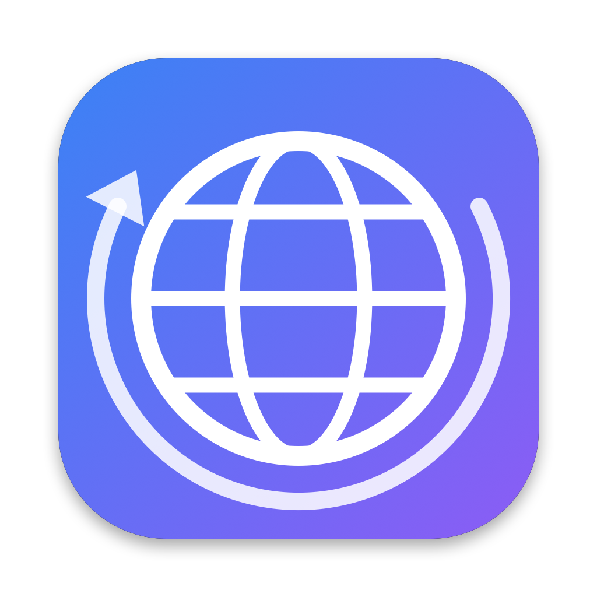
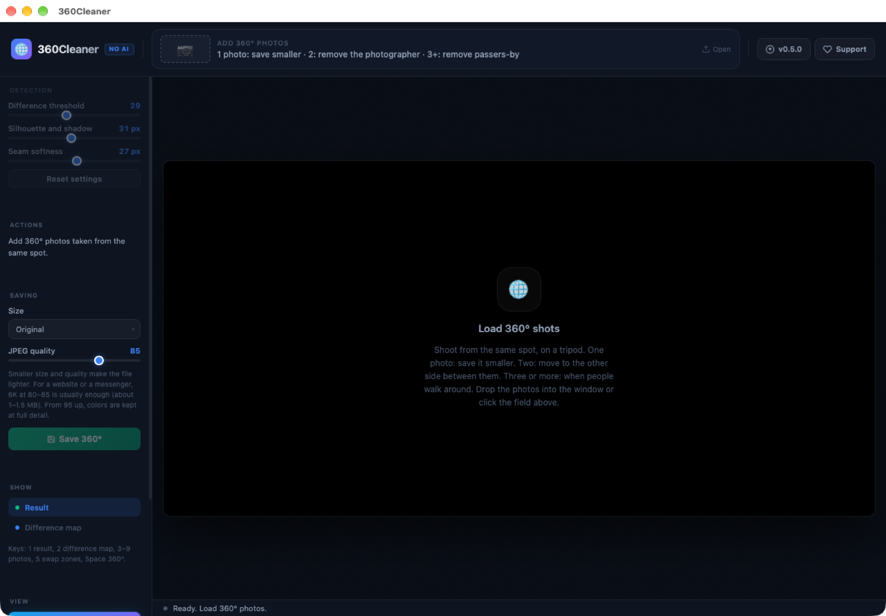

<div align="center">



# 360Cleaner

**ลบช่างภาพและคนที่เดินผ่านออกจากภาพพาโนรามา 360° แล้วบันทึกให้ไฟล์เล็กลงได้ถึง 20 เท่า**

[](https://github.com/DeMoZ/360cleaner/releases/latest)


[](LICENSE)

[English](README.md) · [Русский](README.ru.md) · **ภาษาไทย**

[**⬇ ดาวน์โหลด**](https://github.com/DeMoZ/360cleaner/releases/latest)



</div>

---

## ✨ ทำอะไรได้บ้าง

ถ่ายภาพ 360° สองสามภาพจากจุดเดียวกัน ลากภาพลงในหน้าต่าง แล้วบันทึกผลลัพธ์ สิ่งที่โปรแกรมทำขึ้นอยู่กับจำนวนภาพ:

| ภาพ | โหมด | ผลลัพธ์ |
| :---: | :--- | :--- |
| **1** | บันทึกใหม่ | ไม่มีอะไรต้องลบ: บันทึกพาโนรามาใหม่ตามขนาดและคุณภาพที่เลือก |
| **2** | ช่างภาพ | ในสองภาพคุณยืนคนละฝั่ง แต่ละจุดจะนำมาจากภาพที่ไม่มีคุณอยู่ |
| **3+** | คนเดินผ่าน | สำหรับที่ที่มีคนเยอะ: แต่ละบริเวณจะนำมาจากภาพที่ตรงนั้นไม่มีใคร |

- **ไม่ใช้ AI ไม่มีการวาดเติม** ใช้เฉพาะพิกเซลจริงจากภาพของคุณ คมชัดเท่าต้นฉบับ
- **ยังเป็นภาพ 360°** ข้อมูล XMP GPano, EXIF และโปรไฟล์สี ICC ถูกคัดลอกไปด้วย Google Photos, Facebook, แว่น VR
  และ Insta360 Studio จึงเปิดผลลัพธ์เป็นทรงกลมได้
- **บันทึกได้ตรงกับที่เห็น** ไฟล์ที่บันทึกตรงกับภาพตัวอย่างทุกประการ
- **หน้าจอ 8 ภาษา**: English, Русский, Español, Português, Deutsch, Français, 中文, 日本語

## 📦 ติดตั้ง

ดาวน์โหลดเวอร์ชันล่าสุดจากหน้า [**Releases**](https://github.com/DeMoZ/360cleaner/releases/latest)

<details open>
<summary><b>macOS</b> (Apple Silicon)</summary>

1. เปิด `360Cleaner-macOS-v….dmg` แล้วลากแอปไปที่ **Applications**
2. แอปไม่ได้ลงนามด้วยใบรับรองของ Apple macOS จึงบล็อกการเปิดครั้งแรก: กด **Done** เปิด
   **System Settings → Privacy & Security** แล้วกด **Open Anyway**

ไฟล์ `…-macos-arm64.zip` ในหน้ารีลีสใช้สำหรับอัปเดตภายในแอป ไม่ต้องดาวน์โหลด
</details>

<details open>
<summary><b>Windows</b> 10 / 11</summary>

1. แตกไฟล์ `360Cleaner-…-windows-x64.zip` แล้วเปิด `360Cleaner.exe`
2. SmartScreen: กด **More info → Run anyway**

ต้องมี Microsoft Edge WebView2 ซึ่งปกติ Windows 10/11 มีอยู่แล้ว
</details>

หลังจากนั้นแอปจะอัปเดตตัวเอง: ปุ่มเลขเวอร์ชันที่มุมขวาบน และการตรวจสอบอัตโนมัติวันละครั้ง (ปิดได้)

## 📸 วิธีถ่าย

1. ตั้งกล้องบน **ขาตั้ง** ภาพที่ 1: ยืนอยู่ฝั่งหนึ่ง
2. โดยไม่ขยับขาตั้ง เดินไป **ฝั่งตรงข้าม** แล้วถ่ายภาพที่ 2 ถ้ามีคนเดินไปมา ให้ถ่ายเพิ่มอีกสองสามภาพ
   ยิ่งมีภาพมาก ยิ่งมีโอกาสที่ทุกจุดจะว่างอย่างน้อยในหนึ่งภาพ
3. **ลากภาพ** ลงในหน้าต่าง (ทั้งหมดพร้อมกัน) หรือคลิกช่องด้านบน ภาพจะแสดงในรายการด้านล่าง: คลิกเพื่อดูภาพ
   ✕ เพื่อเอาภาพออก **Clear list** เพื่อเอาออกทั้งหมด
4. กรณีสองภาพ: ถ้ายังเห็นตัวคุณอยู่ ให้กด **Swap zones** (ปุ่ม <kbd>S</kbd>)
5. เลือก **ขนาด** และ **คุณภาพ** แล้วกด **Save 360°**

> [!TIP]
> ได้ผลดีที่สุดเมื่อระหว่างภาพมีแค่คนที่เปลี่ยนไป: ค่าแสงคงที่ (โหมดแมนนวล) และไม่มีลม

## 🪶 ขนาดไฟล์

พาโนรามา 16K จากกล้อง (15520×7760) มีขนาดราว 23 MB น้ำหนักเกือบทั้งหมดมาจากจำนวนพิกเซล โปรแกรมดูภาพ 360°
แสดงบนจอครั้งละราวหนึ่งในสี่ของวงรอบ ดังนั้น **6K–8K ก็เพียงพอสำหรับภาพคมชัดเต็มจอ**

| ขนาด | คุณภาพ | ไฟล์ |
| :--- | :---: | ---: |
| ต้นฉบับ 15520×7760 | 95 | 22 MB |
| ต้นฉบับ 15520×7760 | 85 | 7.2 MB |
| 8K, 8192×4096 | 85 | **2.5 MB** |
| 6K, 6144×3072 | 85 | **1.6 MB** |
| 5K, 5120×2560 | 80 | **1.0 MB** |
| 4K, 4096×2048 | 80 | **0.7 MB** |

โปรแกรมย่อภาพด้วย Lanczos และบันทึกเป็น JPEG แบบ progressive ที่ปรับตารางให้เหมาะสม สี 4:2:0
(ตั้งแต่คุณภาพ 95 ขึ้นไปเป็น 4:4:4) ขนาดพาโนรามาในข้อมูล GPano จะปรับตามขนาดใหม่

## 🎛 การตั้งค่า

| การตั้งค่า | ทำอะไร |
| :--- | :--- |
| **Difference threshold** | ภาพต้องต่างกันแค่ไหน (ΔE ใน Lab) ลดลงถ้าสีเสื้อผ้าคล้ายฉากหลัง เพิ่มขึ้นถ้าใบไม้หรือนอยส์ถูกจับไปด้วย |
| **Silhouette and shadow** | ขยายบริเวณที่พบออกไปแค่ไหน: ผม ขอบเสื้อผ้า เงาบนพื้น |
| **Seam softness** | ความกว้างของรอยต่อแบบนุ่มนวลระหว่างภาพ |
| **Swap zones** | เฉพาะสองภาพ: สลับว่าแต่ละโซนนำมาจากภาพไหน |
| **Difference map** | สองภาพ: โซน A สีฟ้าและโซน B สีแดง คือที่ที่พบคน สามภาพขึ้นไป: แต่ละบริเวณเป็นสีของภาพที่นำมา (สีเดียวกับจุดในรายการภาพ) |
| **Size, JPEG quality** | ขนาดและคุณภาพที่ใช้บันทึก ไม่มีการขยาย: จะไม่แสดงขนาดที่ใหญ่กว่าต้นฉบับ |
| **360° sphere** | ดูแบบโต้ตอบ: ลากด้วยเมาส์ เลื่อนลูกกลิ้งเพื่อซูม <kbd>Space</kbd> เพื่อสลับ |
| **Aspect ratio** | กรอบ 2:1, 16:9, 4:3, 1:1, 9:16 หรือ 4:5 ใช้สำหรับดูเท่านั้น |

หน้าจอโปรแกรมยังไม่มีภาษาไทย ชื่อการตั้งค่าในตารางจึงเป็นภาษาอังกฤษตามที่เห็นในแอป

**ปุ่มลัด:** <kbd>1</kbd> ผลลัพธ์ · <kbd>2</kbd> แผนที่ความต่าง · <kbd>3</kbd>–<kbd>9</kbd> ภาพ · <kbd>S</kbd>
สลับโซน · <kbd>Space</kbd> 360° · <kbd>⌘/Ctrl</kbd>+<kbd>O</kbd> เพิ่มภาพ · <kbd>⌘/Ctrl</kbd>+<kbd>S</kbd> บันทึก

## 🛠 คอมไพล์จากซอร์สโค้ด

Rust + WebView ของระบบ (tao + wry) ประมวลผลแบบขนานด้วย Rayon

```bash
cargo run --release                         # เปิดโปรแกรม
cargo run --release -- a.jpg b.jpg c.jpg    # เปิดพร้อมภาพ
cargo test                                  # ทดสอบ
scripts/build-macos.sh                      # dist/360Cleaner.app, .dmg และ .zip สำหรับอัปเดต (Apple Silicon)
```

## ❤️ สนับสนุน

โปรแกรมนี้ใช้ฟรี ปุ่ม **Support** ในหน้าต่างจะแสดงช่องทางบริจาค รายการมาจาก
[DeMoZ/donations](https://github.com/DeMoZ/donations)

## 📄 สัญญาอนุญาต

[MIT](LICENSE)
